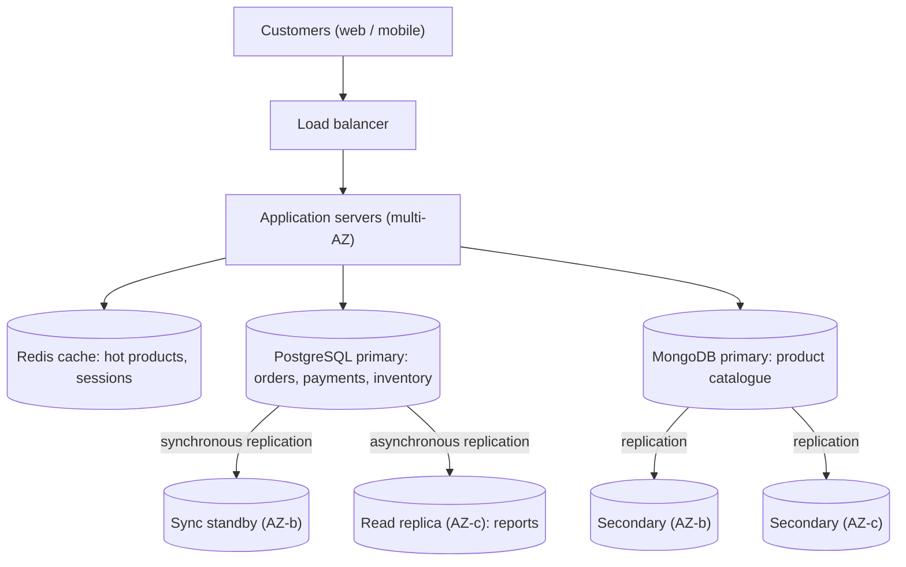

# Porfolio 1: Database Design and Modelling

## Case Study

CashFlow is a simulated online store selling clothes, accessories.
-Users: Customers, Store Administrators, delivery staff.
-Main Data: Customers, Products, Orders, Order items, Payments, Addresses, Deliveries.
-Key Operations: Adding products, Placing orders, Tracking delivery, Processing payments, Updating stock

## What I did

1. Installed PostgreSQL(version 18.6-5) and created a database called CashFlow
2. Ran the code in the schema.sql to create 8 tables
3. Checked tables and constraints in pgAdmin
4. Created an ER diagram(screenshots/ER-Diagram.png)

# Portfolio 2: Query Processing and Optimisation (CashFlow)

Database: PostgreSQL. Uses the schema from `Portfolio-1_database-design/schema.sql`.

## How I implemented and tested this
1. Ran `01_seed_data.sql` to generate 50k customers, 5k products, 200k orders and 600k order items.
2. Ran each query in `02_queries.sql` with `EXPLAIN (ANALYZE, BUFFERS)` *before* indexing and saved the plans in `execution-plans` folder.
3. Created indexes with `03_indexes.sql`.
4. Re-ran the same queries and saved the "after" plans.
5. Compared results in the table below.

## Query processing in brief
PostgreSQL parses the query, rewrites it, and the **planner** estimates the cost of alternative plans (sequential scan vs index scan, nested loop vs hash join vs merge join) using table statistics, then the executor runs the cheapest. `EXPLAIN ANALYZE` shows both the estimate and what really happened.

## Results

| Query | Before: plan type | Before: time (ms) | Index used | After: plan type | After: time (ms) | Improvement |
|-------|-------------------|-------------------|------------|------------------|------------------|-------------| 
| Q1 customer orders | Seq Scan | 91.299 | idx_orders_customer | Index Scan | 17.477 | Much Faster |
| Q2 pending orders | Seq Scan | 199.000 | idx_orders_status_date | Index Scan | 4.487 | Much Faster |
| Q3 order details join | Seq Scan | 345.919 | idx_orders_customer | Index Scan | 0.181 | Much Faster |
| Q4 top products | Seq Scan | 681.992 | idx_order_items_product | Index Scan | 73.208 | Much Faster |
| Q5 monthly revenue | Seq Scan | 234.739 | idx_payments_success_paid_at | Index Scan | 73.567 | Much Faster |
| Q6 category + price | Seq Scan | 6.398 | idx_products_category_price | Index Scan | 0.210 | Much Faster |


## Performance analysis
- Q1/Q3: Before the index, PostgreSQL had no shortcut, so it read each of the 200,000 orders and removed the ones that didn’t belong to the customer. That’s the big “rows removed by filter” number in the plan. After the index, it moves straight to that customer’s few orders, like using a book’s index instead of reading every page.

- Q2: The index sorts rows by status first, then by date within each status. PostgreSQL goes to PENDING, then reads the recent dates next to each other. If the date came first, the pending orders would be scattered all through the index. The rule: put the column you test with = first, and the range column (>=) second.

- Q4: An index helps when you want a small part of a table. Here PostgreSQL needs nearly all the rows, so reading them in order (a Seq Scan) is faster than jumping back and forth through an index. Most of the time goes on scanning, joining and grouping, which an index can’t speed up.

- Q5: A partial index only covers rows that match a condition, here status = 'SUCCESSFUL'. It’s smaller, faster to search and cheaper to keep updated, because failed or pending payments aren’t in it. In our test data every payment is successful, so the saving is small. In a real shop with many failed payments it would matter more.

   #  TradeOffs
- Storage: Every index takes disk space. For Example "idx_orders_customer" used 6.168MB

- Slow writes: Every INSERT, DELETE or UPDATE must also update each index on that table. with several indexes on orders, each new order does  extra work.

- The lesson: only index columns your queries actually use. More indexes isnt better.


## Evidence folder contents
- `execution-plans/` before/after text outputs
- `screenshots/` query results and plan outputs


# Portfolio 3: Transactions and Concurrency (CashFlow)

Database: PostgreSQL. Builds on the Portfolio 1 schema and Portfolio 2 seed data.

## Files
- `00_test_setup.sql` creates two test products (one with 5 in stock, one with 0)
- `01_commit_rollback.sql` atomicity: commit, rollback, savepoint
- `02_concurrency_demos.md` two-session demos of lost update, locking, isolation levels, deadlock

## Why transactions matter for e-commerce
Placing an order changes several tables at once (orders, order_items, products stock, payments). These must succeed or fail **together** (ACID):
- Atomicity: all steps happen or none do (Tests 1, 2, 4)
- Consistency: constraints such as `stock_quantity >= 0` are never violated
- Isolation: simultaneous customers do not corrupt each other's work (Demos 1 to 5)
- Durability: committed orders survive a crash (PostgreSQL write-ahead log)


# Portfolio 4: NoSQL and Advanced Data Models (CashFlow, MongoDB)

Same case study as Portfolios 1 to 3. Model type: **document database (MongoDB)**.

## How to run
1. Install MongoDB Community Server and `mongosh`.
2. `mongosh --file 01_setup_and_insert.js` creates the `CashFlow` database, validation rules, indexes and sample data.
3. Ran `02_queries_and_indexes.js` (whole file or section by section) and screenshot each section's output.

## Document model

| Relational (Portfolio 1) | MongoDB collection | Design decision |

| customers + addresses | `customers` | Addresses *embedded* (always read with the customer) |
| products + categories | `products` | Category *embedded*; reviews *embedded*; attributes vary per product type |
| orders + order_items + payments + deliveries | `orders` | Items, payment and delivery *embedded* as a purchase-time snapshot |

**Sample product (document):**
```json

{
  "_id": "ObjectId('6af240928e97050c01eb7267')",
  "sku": "LAP-002",
  "name": "Zen 15 Laptop",
  "description": "Performance laptop for creators",
  "category": {
    "name": "Laptops",
    "path": [
      "Electronics",
      "Computers",
      "Laptops"
    ]
  },
  "price": "NumberDecimal('780000.00')",
  "stock": "NumberInt('5')",
  "specs": {
    "cpu": "Core i7",
    "ramGB": "NumberInt('32')",
    "storageGB": "NumberInt('1024')",
    "screenInch": "Double('15.6')"
  },
  "tags": [
    "laptop",
    "creator",
    "gaming"
  ],
  "reviews": [],
  "ratingAvg": "NumberInt('0')",
  "reviewCount": "NumberInt('0')",
  "createdAt": "ISODate('2026-02-01T00:00:00.000Z')"
}
```
A pair of sneakers instead has `sizes` and `colors` and no `specs`. Both live in the same collection.

# Portfolio 5: Distributed and Cloud Database Design (CashFlow)

Type: discussion-based design. Nothing here was deployed; sample commands are in `appendix-sample-configs.md` and are illustrative only.

#Scenario and assumptions

CashFlow has outgrown a single database server. These figures are "assumptions" for the exercise:

| Factor         | Assumption                                                                         |
|                |                                                                                    |
| Customers      | 20,000 registered                                                                  |
| Orders         | 1,000/day normally; *20x spike* during a flash sale (about 14 orders/minute)     |
| Catalogue      | 10,000 products, mostly reads (about 2 reads per order)                            |
| Users          | Mainly West Africa, some diaspora                                                  |
| Business needs | Never lose a paid order, never oversell, catalogue always browsable                |

## 2. Proposed architecture (polyglot persistence)

Portfolios 1 to 4 showed that different data has different needs, so the design uses two databases.



| Data                        | Database    | Reason                                                 |
| --------------------------- | ----------- | ------------------------------------------------------ |
| Orders, payments, inventory | PostgreSQL  | Needs full ACID, constraints and locking (Portfolio 3) |
| Product catalogue, reviews  | MongoDB     | Flexible attributes, read-heavy (Portfolio 4)          |
| Hot products, sessions      | Redis cache | Takes read load off both databases                     |

## 3. Replication

**PostgreSQL (streaming replication)**

- One primary takes all writes. One "synchronous standby" in another availability zone (AZ) confirms each commit, so a committed order survives losing the primary (RPO close to 0).
- One "asynchronous read replica" serves reports such as Q4/Q5 from Portfolio 2, so heavy analytics never slow checkout. It may lag by seconds.

**MongoDB (replica set)**

- Three nodes across three AZs: one primary, two secondaries. If the primary fails, the others "elect" a new one automatically, typically within seconds.
- Writes use `w: "majority"`, so an acknowledged write exists on at least two nodes and cannot be rolled back after a failover.

**Trade-off": synchronous replication adds latency to every commit and can pause writes if the standby is unreachable. This is accepted for payments but would be too strict for catalogue edits.

## 4. Sharding and partitioning

Replication copies data for safety; sharding *splits* data for capacity. It is needed only when one server can no longer hold the data or handle the writes.

**Orders (the fastest-growing data)**

| Shard key option      | Verdict                                                                           |
|                       |                                                                                   |
| `orderDate` (ranged)  | "Bad" All new orders hit the newest shard, creating a write hotspot               |
| `customerId` (hashed) | "Chosen" Writes spread evenly, and "my orders" (Q1 in Portfolio 2) hits one shard |
| `status`              | "Bad" Very few distinct values, so chunks cannot split                            |

Cost of the choice: admin queries across all customers (revenue reports) must hit every shard, called a scatter-gather query. That is why reports run on a replica or warehouse.

"Catalogue": about 500k documents fits one replica set comfortably, so start unsharded. If it grows, shard on hashed `sku`.

"PostgreSQL": first use "range partitioning of `orders` by month". Old months become cheap to archive and recent partitions stay small and fast. If one primary still cannot cope, shard by `customer_id` (for example with a tool such as Citus, or in the application).

"Inventory hot spots": during a flash sale, thousands of buyers update the same stock row, so locks queue up (the Demo 2 effect from Portfolio 3). Options: a short stock "reservation" in cache, queueing orders, or splitting stock into several counter rows.


## Scenario walkthrough: flash sale

1. Traffic rises 20x. Autoscaled app servers absorb it; Redis serves most product-page reads.
2. Checkout writes go to the PostgreSQL primary with the synchronous standby; stock is reserved atomically (Portfolio 3, Demo 3 style conditional update).
3. Reports are blocked from the primary and run on the read replica.
4. If the primary fails mid-sale, the standby is promoted. Orders already confirmed to customers are safe because they were committed on both.

## Trade-offs and limitations

- Two databases means "more complexity": two backup routines, two skill sets, and no cross-database transaction. An order that touches both needs careful design.
- Sharding is "hard to undo" and a poor shard key is costly, so it is delayed until needed.
- Synchronous replication and majority writes ""cost latency"" in exchange for safety.
- Figures in section 1 are assumptions; real capacity planning needs load testing.


 ## Analysis

Replicaion is not a substitute for backups because replication copies every single change immediately including mistakes. If anyone mistakenly deletes the orders table for example or a bug corrupts any data, the copies remove or corrupt it too. A backup is like a saved picture from an earlier point in time. So you can return to the point before the mistake. Replication protects you when a server breaks, and backups protect you when the data is wrong. You need both.

When it comes "orderDate" it makes for a poor shard key for orders so "customerId" is used instead this is because new order's always have the current date at the time of the order so every order lands on the same shard. That shard gets overloaded while the others sit idle, which defeats the purpose of sharding. With a hashed customerId, orders spread across all shards evenly, and one customer's orders stays together, so showing of orders is fast.


Strong consistency: payment and stock updates. If two customers buy the last item at once, or a payment is recorded twice, the data would be wrong and money or stock would be lost. Everyone must see the same correct value immediately, so it’s better to refuse or delay a request than to give a wrong answer.

Eventual consistency: product reviews or the average rating. If a new review takes a few seconds to appear, or the rating is briefly out of date, nobody is harmed. Allowing this makes the page faster and keeps it working even if a server is unreachable.

When managed services, and when self-managed? Stay on managed services where a cloud provider runs the database for you and when the business is small or mid-sized and has no or doesn't need specialist database team. The provider handles backups, failover, updates and monitoring, which reduces time wastage or saves time and reduces errors. You pay more per unit, but you avoid hiring staff and getting on-call emergencies wrong.

Migrate to self-managed when the data has become very large and the bill becomes a major cost, when you need special settings the provider doesn’t allow, or when rules require data to stay in your own environment. You also need engineers who can run it safely.
